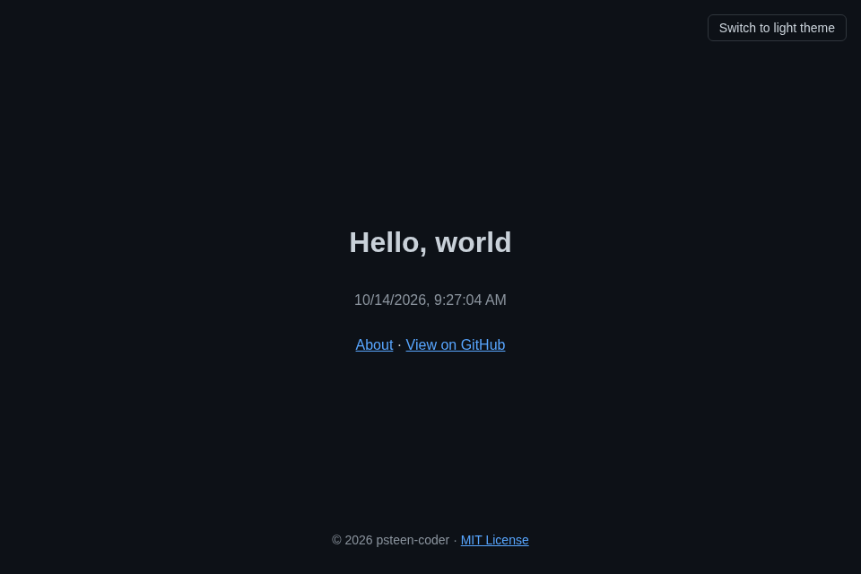

# hello-web

A simple hello-world web app.

## Run / view

This is a static page with no build step.

- Open `index.html` directly in a browser, or
- Serve it locally: `python3 -m http.server 8000` and visit http://localhost:8000

## Formatting

Formatting is handled by [Prettier](https://prettier.io/) with default settings, plus an `.editorconfig` for editors.

- Install dev dependencies: `npm install`
- Format: `npm run format`
- Check: `npm run format:check`

## Linting

CSS is linted with [Stylelint](https://stylelint.io/) using `stylelint-config-standard`.

- Lint CSS: `npm run lint:css`
